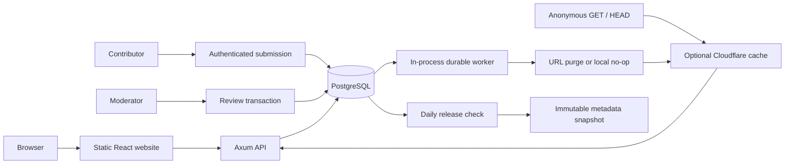

# Architecture

Cardlattice is one Axum/Tokio service, PostgreSQL, and a static React website.
The API process runs a durable publication worker and periodic health probes.
Cloudflare CDN is optional. There is no Redis, per-request Worker, external
catalogue dependency, commerce, pricing, or inventory subsystem.

## Identity and games

UUIDv7 identifiers belong to Cardlattice. Games, series, sets, card identities, and
printings use a common identity table with constrained discriminators and typed
read views. This is single-table inheritance, not a claim that every game has the
same concepts. A printing belongs to exactly one game, card identity, and set;
language, region, collector number, rarity and release date remain printing data.
Foil finishes and stamps belong in printing variants. Reprints remain distinct.

Attributes are bounded JSON objects. Pokémon card attributes have a typed adapter
for category, HP, types and stage. Other games accept bounded core attributes until
their own adapter is supplied; they do not inherit Pokémon validation accidentally.
The first adapter is intentionally small and does not model every Pokémon rule.

## Read consistency

Queries bind user values through SQLx; dynamic query fragments come only from fixed
code branches. Requests use bounded limits (default 20, maximum 100), opaque
query-scoped keyset cursors, stable canonical-name/UUID ordering, and a three-second
database statement timeout. Full-text search uses `simple` tokenisation plus a GIN
trigram substring fallback for scripts where word tokenisation is insufficient.
NFKC normalisation and Unicode lowercasing preserve multilingual input. This is
Unicode-aware, not a linguistic stemming engine or accent-insensitive search.

Pagination is a live view, not a snapshot-isolated multi-request export. Changes to
sort keys during traversal may move records; use versioned datasets for reproducible
iteration. Names fall back to the canonical record when a requested translation is
absent. Cursor ordering uses canonical names even when display names are translated.

## Write and publish consistency

1. Submission verifies a contributor capability, terms, field constraints,
   duplicate fingerprint, idempotency key, and update base timestamp.
2. Moderation takes an advisory transaction lock and locks the submission row.
   Stale edits, invalid relationships, and duplicate canonical records fail before
   commit. Approve/reject decisions are auditable.
3. Approval commits metadata, provenance, revision, decision, contribution status,
   and outbox event atomically. No submitted image is promoted by this transaction.
4. Committed records are immediately available at the origin. A worker claims an
   invalidation event using `FOR UPDATE SKIP LOCKED` and purges affected URLs.
5. The event completes after purge succeeds. Without Cloudflare, purge is an
   explicit successful no-op. Daily export failures never hold up API invalidation.
6. Errors persist attempts and next-attempt time. Backoff starts at five seconds,
   doubles, and caps at one hour. Ten failures move an event to `failed`; the
   moderator can replay it. A process crash rolls back the claim, permitting retry.

A separate check runs on startup and every minute, publishing at most once per UTC
day when non-synthetic catalogue data has changed. The first release is available
as soon as real metadata exists; subsequent changes wait until the next UTC day.
Unchanged days produce no release. A database advisory lock and unique active
release-date index prevent concurrent duplicate releases. Export uses repeatable
read, streaming, checksums and atomic rename; failures retry the next minute.
Internal revision IDs are audit watermarks, not release counts; PostgreSQL sequence
gaps from rollback are expected. Public releases are identified by date.

Snapshots are immutable, schema-versioned NDJSON containing public core metadata,
never synthetic fixtures, private scans, credentials, contributor identities, or
internal audit details. Withdrawn manifests remain private audit records; both
listing and download endpoints exclude them, even for conditional GET/HEAD.
Supplementary localisation/variant/source exports are not yet included. Metadata
accepted by this first release must be CC0-compatible; artwork is separate.

The local worker is intentionally conservative: one event per five-second tick,
12 database connections, bounded purge batches, a 15-second HTTP timeout. Batch
coalescing and a separate worker command are future scaling improvements. Multiple
API replicas require shared snapshot storage. A single deployment uses a persistent
volume. Temporary files from interrupted exports need periodic operational cleanup.

## Cache consistency

Unfiltered record URLs have one-day shared TTLs; collections/stats/manifests have
60-second shared TTLs. Browser TTL is 15 seconds. ETags hash exact JSON bytes;
conditional GET/HEAD preserve validators. If-None-Match takes precedence over
If-Modified-Since. HTTP dates are second-granularity, so comparison conservatively
returns 200 when a stored timestamp is later within the same second.

Outbox paths cover the changed record, parent card/set (old and new), game and
default collections. Query-bearing requests are bypassed by the supplied CDN rules;
origin headers bound other shared caches to 60 seconds. Search and supplementary
relationships are therefore bounded even when exact URL enumeration is impossible.
An origin request already in flight can fill a cache after a purge; TTL is the
ultimate staleness bound. This design does not claim linearizable CDN reads.

## Access and operational boundaries

Public GET/HEAD requests are anonymous. Public CORS allows GET/HEAD only; the UI
uses a same-origin proxy for writes. Separate random contributor, moderator and
metrics capabilities come from environment or secret files. Tokens are hashed for
audit identity and never put in URLs or browser storage. Shared capabilities are a
deliberate initial mechanism, not per-person authentication.

Submission budgets are PostgreSQL-backed per capability. Search budgets use the
actual socket peer, never an untrusted forwarded header. Behind a reverse proxy,
that budget is shared by the proxy's traffic: use edge rate limiting for per-user
limits and plan a trusted-proxy policy before multi-instance public deployment.
Scan uploads are byte- and decode-limited PNG/JPEG files stored privately in
PostgreSQL. They are served to moderators as attachments with no-store and nosniff.
